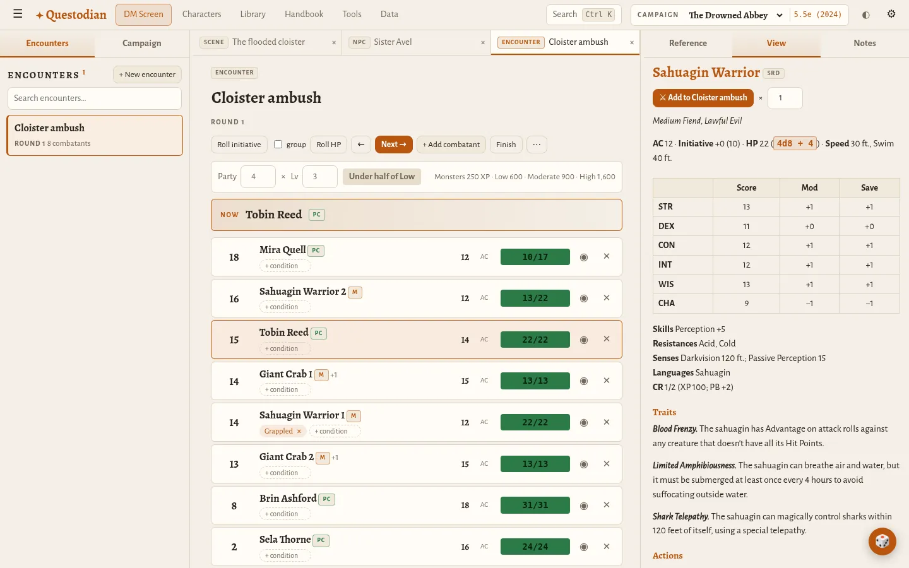

# Questodian documentation

Questodian is a campaign manager and DM screen for 5e, for the 2014 rules (SRD 5.1) and the 2024
rules (SRD 5.2.1). It runs on your own computer, offline, as a desktop app or in a browser, and on
an iPad as a web app.

The screenshots in these pages show an invented demo campaign, *The Drowned Abbey*.

## Using Questodian

| Page | What's in it |
|---|---|
| [Getting started](guide/getting-started.md) | Which file to download, the first launch, where your data lives, running it in a browser |
| [The DM screen](guide/dm-screen.md) | The navigator, tabs, the reference panel, encounters, sessions, linking notes, Ctrl K search |
| [Maps and handouts](guide/maps-and-handouts.md) | Images and maps, the map tools, showing them to players, exporting |
| [Characters](guide/characters.md) | The character builder, sheets filled in by hand, rests, the rules data editor |
| [Dice](guide/dice.md) | The quick roll, the Tools page roller, clicking to roll, dice syntax |
| [Library, Handbook, Tools and Settings](guide/other-pages.md) | The SRD library, your own documents, calculators, arranging any page, the theme |
| [Data and backups](guide/data-and-backups.md) | Exports and imports, automatic backups, moving to another computer |
| [The web version](guide/web-version.md) | Questodian in a browser, on an iPad: the Home Screen, backups, moving data, players' view |
| [Updates](guide/updates.md) | How the desktop app finds and installs new versions |
| [Command line](guide/command-line.md) | The `questodian` command: serve, roll, calc, srd, export, import |
| [Troubleshooting and known issues](guide/troubleshooting.md) | First-launch warnings, common problems, mistakes in the bundled data |

## Working on Questodian

| Page | What's in it |
|---|---|
| [Development](dev/development.md) | Setting up, `make` tasks, how the code is laid out, tests and CI |
| [Database and migrations](dev/database.md) | The schema, upgrading old databases, fixtures |
| [Releasing](dev/releasing.md) | Version bumps, the Release workflow, update signing, publishing |
| [Bundled data](dev/data.md) | Where the SRD and the character builder's rules data come from, and how to rebuild them |

Background:
- [The Rust port](rust-port.md): how and why the first, Python version was rewritten.
- [Rules audit](rules-audit.md): the rules checks made against the SRD during the port.
