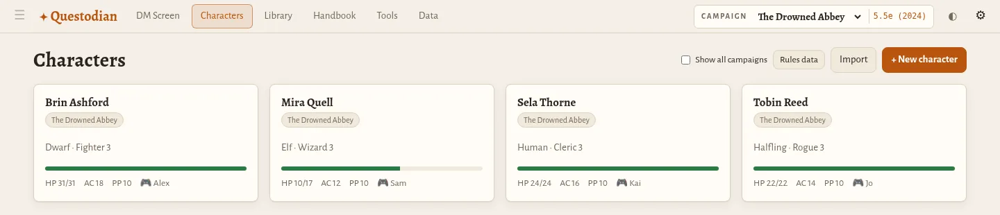
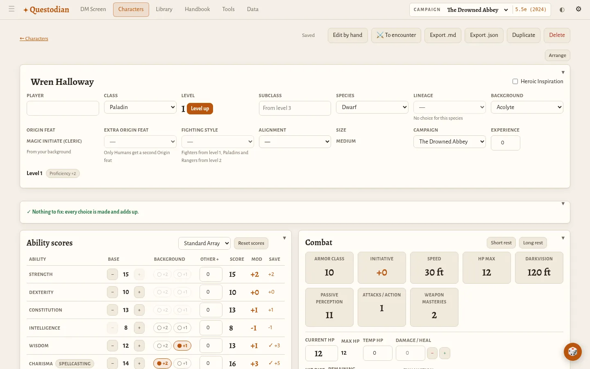
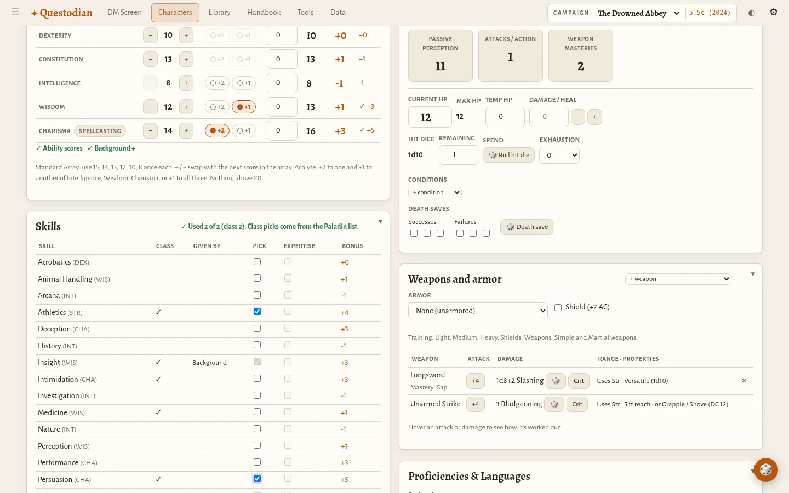
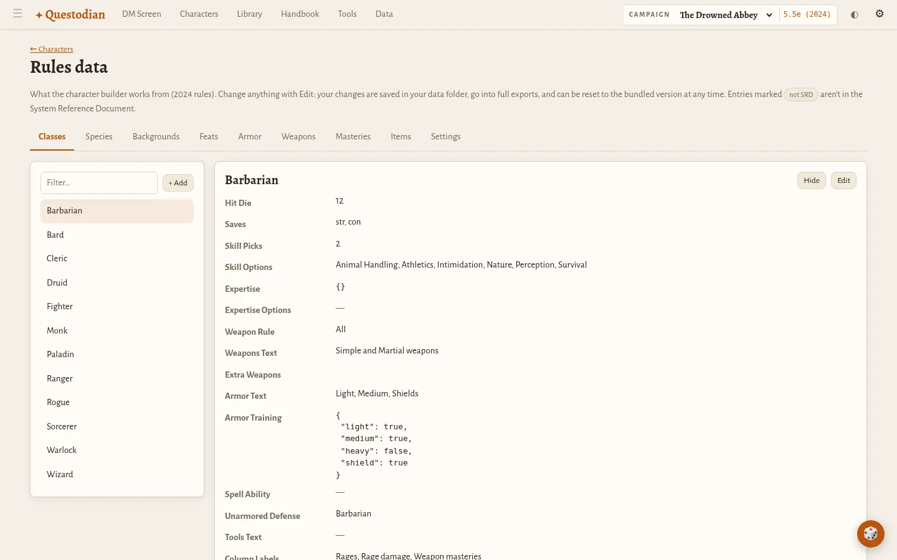

# Characters

[Documentation](../README.md) › Characters

The **Characters** page lists every character, with HP, AC, passive Perception, the player and the
campaign. **+ New character** makes one in the open campaign; **Show all campaigns** lists the
others too. A sheet can be made with the character builder, or filled in by hand.

## The character builder (2024 rules)

New characters start in the builder, which works the sheet out from your choices. (A sheet made
by hand or imported shows **Use the builder** at the top.)

1. Pick a class, species (and lineage, where there is one) and background.
2. Set the ability scores:
   - **point buy**, with − / +;
   - the **standard array**, dealt out to suit your class;
   - **rolls**.

   Then click the background's **+2 / +1** (or **+1** on all three). **Reset scores** starts again.
3. Choose skills, Expertise and the like where your class or background offers them. Expertise is
   limited to what your class and level allow.

From those choices it works out saves, skills, AC, HP, speed, initiative, attacks, weapon
masteries, class resources, spell slots and features. Each number has a note on how it was worked
out, and **warnings** list anything still to choose.

- **Level up** walks through the new level: hit points (roll, or take the fixed value), new
  features and choices. Each level is kept in the **level log** at the bottom of the sheet.
- **Fill starting gear** (in the Inventory panel) fills the inventory with the class and
  background's starting equipment and gold.
- **Spells:** choose and prepare spells only up to what your level can cast. **+ From SRD** adds
  spells from the class's list; **+ From a feature** adds ones a feat or feature grants, such as
  Magic Initiate.

**Edit by hand** (top of the sheet) turns the builder off for that sheet, so you can type anything.
**Back to the builder** turns it on again and works everything out from your choices once more.
Switching to the builder replaces what's typed in the worked-out places. Your spells, inventory,
coins, notes and anything you added yourself stay.

The builder uses the 2024 rules only. Some of its backgrounds and origin feats aren't in the SRD;
see [Rules data](#rules-data).

## Sheets filled in by hand

Without the builder, every part of the sheet is yours to fill in:
- multiclassing;
- abilities and saves;
- skills: proficiency, expertise, half, and Jack of All Trades;
- HP, hit dice, death saves, conditions and exhaustion;
- attacks, with to-hit, damage and critical rolls;
- spellcasting: DC, attack bonus, slots from your class levels, and spells from the SRD;
- class resources, inventory with carrying weight, coins, features and personality.

The sheet follows the rules edition of the character's campaign.

## On either kind of sheet

- **Click any number to roll it:** a skill, a save, an attack, damage.
- **Short rest** and **Long rest** restore what each rest restores: hit points, spell slots,
  resources.
- **⚔️ To encounter** adds the character to the campaign's running encounter (or the one you last
  edited).
- **Duplicate**, **Export .json**, **Export .md** and **Delete** are at the top of the sheet.
- Like every page, the sheet's panels can be moved, resized, folded and hidden: see
  [Arranging a page](other-pages.md#arranging-a-page).

## Rules data

**Rules data** (on the Characters page) lists everything the builder works from, in tabs:
**Classes** (with what each level gives), **Species**, **Backgrounds**, **Feats**, **Armor**,
**Weapons**, **Masteries**, **Items**, and **Settings** (such as point-buy costs, the standard
array and the highest score).

You can change any entry:
- **Edit** an entry, change it, then **Done** to save. It asks first, because the builder uses the
  change for every character straight away.
- **Reset** puts a changed entry back to the bundled version.
- **+ Add** your own entries, and delete them again.
- **Hide** an entry so the builder stops offering it (characters already using it keep it), and
  **Bring back** a hidden one.

Your changes are kept in backups and exports (see [Data and backups](data-and-backups.md)).

Entries tagged **not SRD** aren't in the System Reference Document. They're a few 2024 backgrounds
and origin feats, included by the project owner's choice, and the SRD's licence doesn't cover them.
