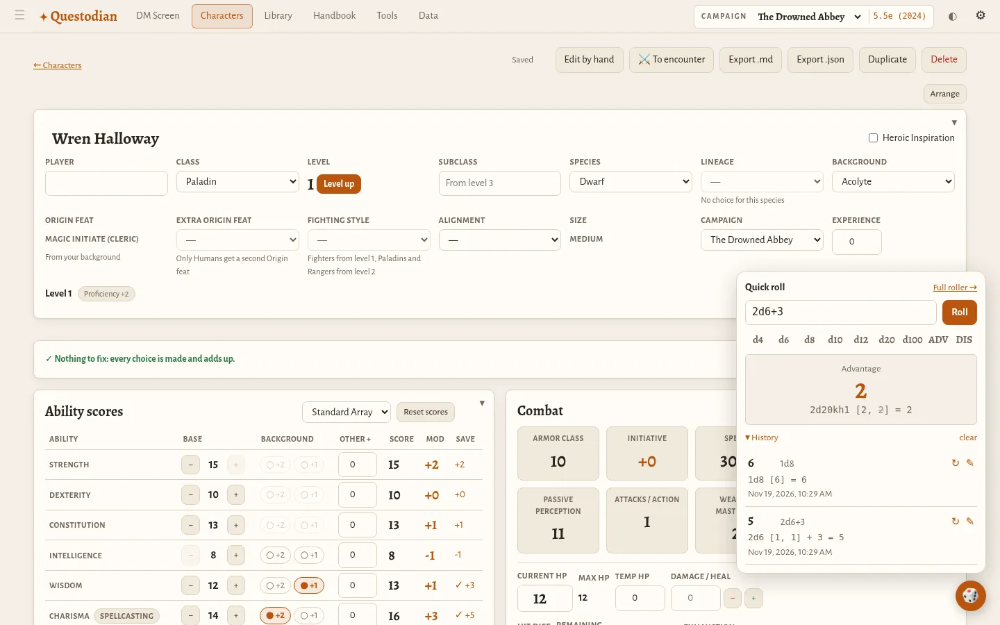

# Dice

[Documentation](../README.md) › Dice

## The quick roll

The 🎲 button at the bottom right of every page (except Tools, which has the full roller) opens the
quick roll. Press **R** to open or close it, when you're not typing in a field; **Escape** closes
it.

- Type an expression and press **Enter** or **Roll**, or click a die: d4 to d100, **ADV** or
  **DIS**.
- The last result shows large, with how it was rolled. It's green on a natural 20 and red on a
  natural 1.
- **▸ History** unfolds your earlier rolls. On each one, **↻** rolls it again and **✎** adds it to
  the open session's log. **clear** empties the history.
- **Full roller →** goes to the Tools page.

While the quick roll is open, rolls show there. When it's closed, each roll pops up briefly in the
corner instead.

## Rolling from anywhere

Highlighted dice in the app roll when you click them. That includes attacks and damage in stat
blocks, spells and notes (`+6`, `2d8+3`), and every number on a character sheet.

## The Tools page roller

- **Dice pool:** click a die to add it, right-click to remove one. Set a **Modifier**, and roll a d20
  normally, with **Advantage** or with **Disadvantage**. Or type any expression.
- **× (1–20)** rolls it that many times.
- **Save macro** keeps the expression as a one-click **Macro**. Macros are saved in this browser
  (or desktop app) only.
- **Roll history** lists every roll, the quick roll's included.
- The **Calculator** understands dice too.

## Dice syntax

| You type | It means |
|---|---|
| `d20`, `3d6+2` | Dice plus a modifier |
| `2d20kh1`, `adv+5` | Keep the highest (advantage) |
| `2d20kl1`, `dis` | Keep the lowest (disadvantage) |
| `4d6dl1`, `stats` | Drop the lowest; `dh` drops the highest |
| `3d6!` | Exploding dice: a maximum roll adds another die |
| `2d6ro2` | Reroll 1s and 2s once (Great Weapon Fighting) |
| `2d6r1` | Reroll 1s until they aren't 1 |
| `d%` | Percentile |
| `4dF` | Fate dice |
| `(1d8+3)*2`, `floor(8d6/2)` | Arithmetic: `+ − × / // % ^ ( )`, and `floor ceil round abs min max sqrt` |
| `mod(16)`, `prof(5)` | The modifier for a score, the proficiency bonus for a level |

The same syntax works in the [command line](command-line.md): `questodian roll 2d20kh1+5`.
