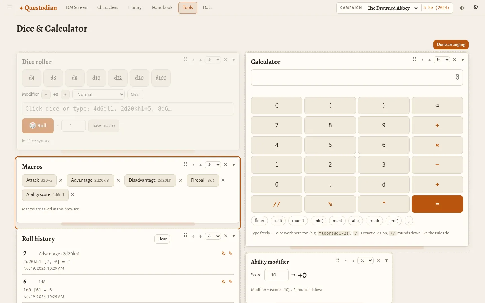

# Library, Handbook, Tools and Settings

[Documentation](../README.md) › Library, Handbook, Tools and Settings

## Library

The whole System Reference Document for the open campaign's edition, with search and filters:

| Edition | What's in it |
|---|---|
| SRD 5.1 (2014 rules) | 319 spells, 334 monsters, classes, races, equipment, conditions, rules and more |
| SRD 5.2.1 (2024 rules) | 339 spells, 341 monsters, classes, species, weapon mastery, feats, rules and more |

## Handbook

Your own documents in Markdown, such as house rules, lore or random tables, with a live preview. A
new entry can start from a template: House Rules, NPCs, Locations, Factions, Items, Lore, Random
Tables or Other. Entries can belong to a campaign or to all of them, and export as JSON or
Markdown. Importing a `.md` file on the Data page makes a handbook entry.

## Tools

- The dice roller, macros and roll history: see [Dice](dice.md).
- A **Calculator** that understands dice.
- Quick calculators:
  - ability modifier;
  - point buy;
  - encounter XP;
  - XP to level;
  - coin splitter;
  - spell DC.

## Arranging a page

Every page is made of panels, and you can lay each page out the way you like:

- **▾** on a panel folds it to its title; **▸** opens it again.
- **Arrange** (top right of the page) turns on the controls:
  - drag a panel by **⠿** onto another to move it there (Escape cancels), or use **↑ ↓**;
  - set its width: ⅓, ½, ⅔ or full;
  - drag its bottom edge to set its height; double-click the edge to fit the content again;
  - **✕** hides it. Hidden panels are listed at the top; click one to bring it back.
- **Done arranging** finishes, and **Reset layout** goes back to the page's own layout.

Each page remembers its layout on this computer (per browser, or per desktop app).

## Settings

Open **⚙** in the top bar.

- **Updates** (desktop app): **Check for updates once a day** and **Check now**. When a new
  version is out, **Update to …** and **What's new** (its release page) appear here. See
  [Updates](updates.md).
- **Appearance:** dark (the default) or light. **◐** in the top bar switches too.
